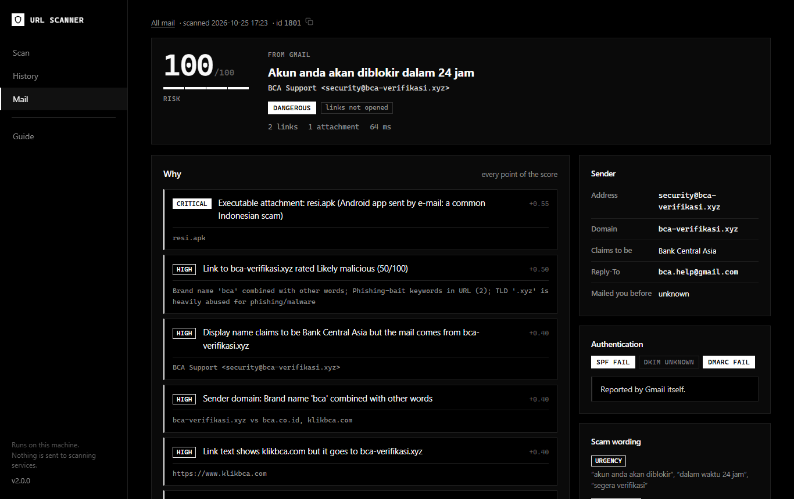

# Gmail inbox scanner

Scores every message in your Gmail inbox: who sent it, what it says, where its links go, what is attached,
and any QR codes it contains. Risky messages get a `URLscanner/Suspicious` or `URLscanner/Dangerous` label
in Gmail. Everything runs on your machine.


- [Setup](#setup)
- [Everyday use](#everyday-use)
- [What it does to your mailbox](#what-it-does-to-your-mailbox)
- [Links are never opened](#links-are-never-opened)
- [How a message is scored](#how-a-message-is-scored)
- [Deep scan](#deep-scan)
- [Watching for new mail](#watching-for-new-mail)
- [Measuring accuracy](#measuring-accuracy)
- [Troubleshooting](#troubleshooting)

## Setup

1. Turn on **2-Step Verification** for your Google account.
2. Create an **App Password** at <https://myaccount.google.com/apppasswords>. Name it something like
   "URL Scanner".
3. Copy `.env.example` to `.env` and fill in:
   ```ini
   GMAIL_ADDRESS=you@gmail.com
   GMAIL_APP_PASSWORD=abcd efgh ijkl mnop
   SCANNER_ACCESS_TOKEN=pick-a-long-random-string   # needed for the web Mail page
   ```
4. Check the connection:
   ```bash
   python cli.py gmail test
   ```
   It logs in, lists the folders it can see (Inbox, Spam, All Mail), and counts recent messages.

> **About App Passwords.** An App Password gives *full* access to the mailbox over IMAP and SMTP. It is not
> limited to reading. Keep it only in `.env` (git-ignored), never paste it anywhere else, and revoke it on the
> same Google page when you stop using the scanner. Work or school accounts may have App Passwords or IMAP
> disabled by their administrator.

## Everyday use

```bash
python cli.py gmail scan --days 3 --no-label   # first run: read-only, look at the results
python cli.py gmail scan --days 7              # analyse and label
python cli.py gmail scan --unread              # only unread mail (it stays unread)
python cli.py gmail scan --folder spam --no-label --all   # what does it think of your Spam?
python cli.py gmail list -v                    # what was scanned, with message ids
```

In the web UI, open **Mail** (`/mail`). It shows a dashboard of verdicts, a searchable message list, and a
**Scan now** button. Click a message to see every finding, its links, attachments, sender and authentication
details.



Messages that were scanned before are skipped unless you pass `--rescan`. A re-scan updates the message's
entry and keeps the older results as history.

## What it does to your mailbox

| Action | Done? |
|---|---|
| Mark messages as read | **Never.** Messages are fetched with `BODY.PEEK[]` from a folder opened read-only (`EXAMINE`). |
| Move, archive, delete | **Never.** |
| Add a label | Only `URLscanner/Suspicious` or `URLscanner/Dangerous`, on a separate read-write connection. `--no-label` turns it off. |
| Remove a label | Only its own `URLscanner/*` labels, when a later scan changes the verdict (up or down). |
| Store your mail | Only a redacted summary: no message bodies, and every URL has its query string and token-like parts masked (`?token=***`). |

Folders are found by their IMAP special-use flags (`\Junk`, `\All`), so it works whatever language your Gmail
uses.

## Links are never opened

Opening a link from an e-mail is not harmless. It:

- tells the sender your address is real and that you read the message;
- shows them your IP address;
- can use up one-time tokens (password resets, magic logins) or trigger "unsubscribe" or "confirm" actions.

So links in mail are judged **passively**:

- look-alike and brand checks (homographs, typosquats, combosquats);
- your offline threat feeds (see `tools/update_feeds.py`);
- DNS and WHOIS of the **registered domain only**.

The site itself is never contacted. A per-recipient tracking subdomain such as `a1b2c3.track.example` is never
looked up either, because its nameserver would learn the message was processed.

| `SCANNER_MAIL_NETWORK` | Opens links? | Other traffic during analysis |
|---|---|---|
| `dns` (default) | no | DNS + WHOIS of registered domains. Your resolver and the registry see the *domain*, never the URL. |
| `none` | no | none at all (WHOIS only from the local cache) |

A link analysed this way is **Unverified** when nothing was found. That means "nothing bad found yet", not
"proven safe".

Common redirect wrappers are unwrapped offline, so the real destination is judged too. These include
Google `/url?q=`, Outlook SafeLinks, Proofpoint URL Defense and Facebook `l.php`.

## How a message is scored

Every finding has a weight. They combine like independent probabilities (`risk = 1 − Π(1 − weight)`), and the
page lists every one with its evidence.

| Area | Examples |
|---|---|
| Authentication | DMARC/SPF/DKIM failures. Only the **topmost** `Authentication-Results` header written by `mx.google.com` counts as verified, because the sender can forge anything below it. For an uploaded `.eml` the results are shown but not trusted. |
| Sender | Display name claims a brand ("BCA Support") but the address is elsewhere. Display name shows a different address. Look-alike sender domain. Brand-new domain. Domain in a threat feed. Replies go to a free-mail address. |
| Wording | Scam phrases in Indonesian and English, grouped as urgency, prize, money, credentials and investment. **Two or more groups** are needed. Sentences that *warn* about scams ("jangan berikan kode OTP kepada siapa pun") are ignored, because real banks write them in every message. |
| Links | Link text shows one brand but goes elsewhere. Links to platforms anyone can publish on (Google Forms, OneDrive shares, …). QR codes. The risk of the worst link. |
| Attachments | Executables and Android apps (`.apk`), disk images, HTML/SVG pages (especially with a password form), macro documents, archives. Static analysis only: nothing is executed. |
| Combinations | First-time sender asking for money or codes. Forged sender pretending to be a brand. Brand impersonation plus a link to another domain. |

| Verdict | Score | Gmail label |
|---|---|---|
| Dangerous | 70+ | `URLscanner/Dangerous` |
| Suspicious | 35–69 | `URLscanner/Suspicious` |
| Low risk | 10–34 | none |
| No signals found | 0–9 | none |

**Trusted senders.** Add addresses or registered domains, one per line, to `scanner/data/mail_allowlist.txt`.
Those senders are never labelled, but only when Gmail reports DMARC **pass** for a matching From domain. A
forged From line therefore cannot use the allowlist.

## Deep scan

When you want to see a page, ask for it explicitly for one message:

```bash
python cli.py gmail deep <message-id>            # every untrusted link of the message
python cli.py gmail deep <message-id> --url 2    # only link #2
```

or use the **Deep scan** box on the message page. The links are then opened by the full URL scanner, which
analyses TLS, redirects, cloaking, login forms and so on. Keep in mind:

- the sites see your IP address and the full link, including any token in it. A VPN hides your IP, nothing
  more;
- links that look like one-time links (reset, verify, confirm, unsubscribe, or a token in the query) are
  refused unless you add `--yes-token-link` (CLI) or tick the box (web).

## Watching for new mail

```bash
python cli.py gmail watch --interval 300
```

This checks every 5 minutes and analyses only new messages. Its progress is saved after each message, so a
crash or a lost connection never skips or repeats one. On Windows, a **Dangerous** message also pops up a
desktop notification. Only one watcher can run at a time.

To start it automatically, create a Windows Task Scheduler task that runs at log-on with these settings:

- *Program*: `python`
- *Arguments*: `cli.py gmail watch`
- *Start in*: your URLscanner folder

## Measuring accuracy

Scores were tuned by hand, so measure them on your own mail:

1. In Gmail, open messages and choose *⋮ → Download message*.
2. Save phishing or scam messages to `outputs/labeled/phishing/` and normal mail to `outputs/labeled/legit/`.
   That folder is git-ignored and stays on your machine.
3. Run:
   ```bash
   python cli.py gmail eval --trust-auth
   ```

It prints precision, recall and the false-positive rate, and lists every miss and false alarm. Fifty to a
hundred messages give a useful picture.

## Troubleshooting

| Problem | Fix |
|---|---|
| `IMAP login … failed` | Use the App Password, not your normal password, and create it for the same account as `GMAIL_ADDRESS`. |
| `this account exposes no 'all' folder` | In Gmail settings → *Labels*, tick *Show in IMAP* for *All Mail* (and *Spam* to scan it). Until then, "mailed you before" stays *unknown*, and that never counts against a sender. |
| Mail page answers 403 | Set `SCANNER_ACCESS_TOKEN`. The page only answers on `localhost`; add other host names to `SCANNER_ALLOWED_HOSTS`. |
| A real newsletter is labelled | Open it and read the findings. Add the sender to `mail_allowlist.txt`, and include it in your `gmail eval` set. |
| "Not analysed" links | Each message has a 60-second budget (`SCANNER_MAIL_TIME_BUDGET`) and at most 30 links, so one hostile message cannot stall a run. |
