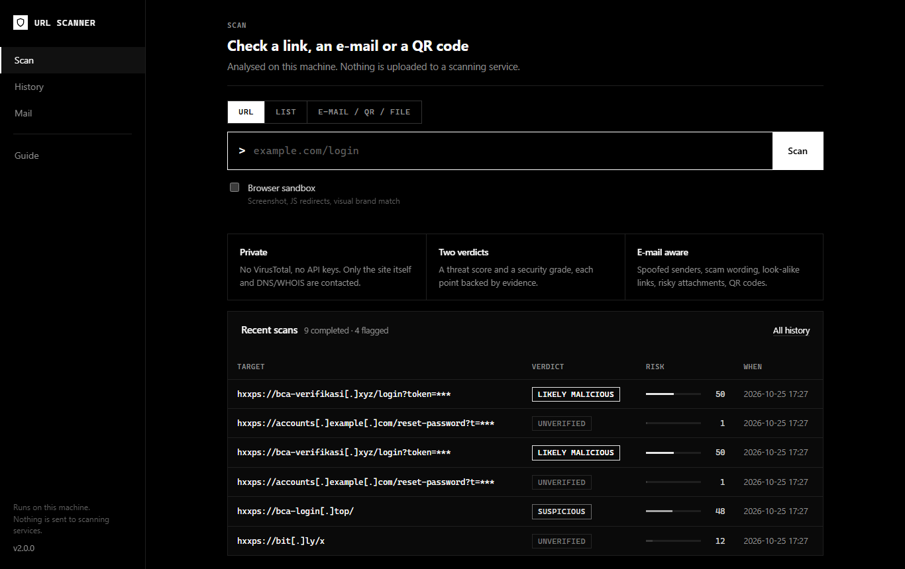
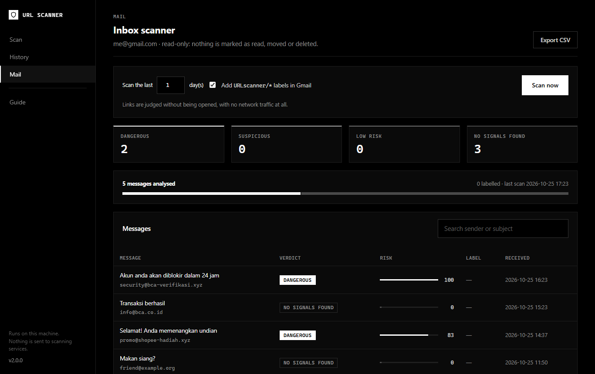

# Panduan URL Scanner (Bahasa Indonesia)

URL Scanner mengecek apakah sebuah link, email, atau QR code berbahaya. Semua analisis berjalan **di
komputer kamu sendiri**: tanpa VirusTotal, tanpa API key, dan link tidak pernah dikirim ke layanan lain.

## Daftar isi

1. [Instalasi](#1-instalasi)
2. [Scan link pertama](#2-scan-link-pertama)
3. [Membaca hasil](#3-membaca-hasil)
4. [Mengecek email](#4-mengecek-email)
5. [Menghubungkan Gmail](#5-menghubungkan-gmail)
6. [Memakai scanner Gmail](#6-memakai-scanner-gmail)
7. [Privasi: apa yang keluar dari komputer](#7-privasi-apa-yang-keluar-dari-komputer)
8. [Threat feed](#8-threat-feed)
9. [Masalah umum](#9-masalah-umum)

## 1. Instalasi

```bash
git clone https://github.com/Adomancer/URLscanner.git
cd URLscanner
pip install -r requirements.txt
copy .env.example .env        # Windows (di Linux/macOS: cp .env.example .env)
python webapp.py              # buka http://127.0.0.1:5000
```

Fitur tambahan (opsional):

```bash
pip install -r requirements-browser.txt && python -m playwright install chromium   # screenshot halaman
pip install -r requirements-qr.txt                                                # membaca QR code
```

## 2. Scan link pertama

Buka halaman **Scan**, tempel link-nya, lalu klik **Scan**. Link yang "dijinakkan" seperti
`hxxps://contoh[.]com` juga bisa. Dari terminal:

```bash
python cli.py scan https://contoh.com
```



## 3. Membaca hasil

Ada **dua penilaian** yang berbeda:

| Penilaian | Artinya |
|---|---|
| **Risiko ancaman (0–100)** | Seberapa mungkin ini phishing atau malware. Setiap poin punya bukti yang bisa kamu baca. |
| **Grade keamanan (A+–F)** | Seberapa baik situsnya dikonfigurasi (TLS, header, DNS). Situs phishing bisa saja dapat A, dan situs bank asli bisa dapat C. |

| Verdict link | Skor | Verdict email | Skor |
|---|---|---|---|
| Malicious | 80+ | Dangerous | 70+ |
| Likely malicious | 50–79 | Suspicious | 35–69 |
| Suspicious | 20–49 | Low risk | 10–34 |
| Clean / **Unverified** | 0–19 | No signals found | 0–9 |

**Unverified** artinya link dianalisis **tanpa membuka situsnya** (ini yang terjadi pada semua link di
email). Tidak ditemukan tanda bahaya, tapi itu bukan jaminan aman.

> Skor adalah petunjuk berbasis bukti, bukan kepastian. Bank asli **tidak pernah** meminta OTP, PIN, atau
> password lewat email, berapa pun skornya.

## 4. Mengecek email

1. Di Gmail, buka email-nya, klik **⋮ → Download message**. Kamu akan mendapat file `.eml`.
2. Di halaman **Scan**, pilih tab **E-mail · QR · file**, lalu seret file itu ke kotak upload.

Dari terminal:

```bash
python cli.py extract pesan.eml --scan
```

Scanner menilai **seluruh email**: pengirim, kata-kata yang dipakai, link, lampiran, dan QR code. Link di
dalamnya **tidak dibuka**, jadi pengirim tidak tahu kamu sedang mengeceknya.

## 5. Menghubungkan Gmail

1. Aktifkan **Verifikasi 2 Langkah** di akun Google kamu.
2. Buat **App Password** di <https://myaccount.google.com/apppasswords> (beri nama misalnya "URL Scanner").
3. Isi file `.env`:
   ```ini
   GMAIL_ADDRESS=kamu@gmail.com
   GMAIL_APP_PASSWORD=abcd efgh ijkl mnop
   SCANNER_ACCESS_TOKEN=isi-dengan-teks-acak-yang-panjang
   ```
4. Cek koneksinya:
   ```bash
   python cli.py gmail test
   ```

> **Penting:** App Password memberi akses **penuh** ke mailbox (bisa membaca *dan* mengirim email). Simpan
> hanya di `.env` (file ini tidak ikut ke git), jangan dibagikan, dan **cabut** di halaman yang sama kalau
> scanner sudah tidak dipakai.

## 6. Memakai scanner Gmail

```bash
python cli.py gmail scan --days 3 --no-label   # percobaan pertama: hanya membaca, tidak mengubah apa pun
python cli.py gmail scan --days 7              # analisis + beri label di Gmail
python cli.py gmail scan --folder spam --no-label --all   # lihat penilaiannya untuk folder Spam
python cli.py gmail list -v                    # daftar email yang sudah di-scan (beserta id-nya)
python cli.py gmail watch                      # pantau terus email baru (cek tiap 5 menit)
```

Versi web ada di menu **Mail**. Di sana ada ringkasan verdict, pencarian, tombol **Scan now**, dan halaman
detail untuk setiap email.



**Yang dilakukan scanner pada Gmail kamu:**

- Email **tetap belum dibaca**. Tidak ada yang dipindah atau dihapus.
- Email berisiko diberi label `URLscanner/Suspicious` atau `URLscanner/Dangerous`. Pakai `--no-label` kalau
  tidak mau ada label sama sekali.
- Isi email tidak disimpan. Yang disimpan hanya ringkasan, dan token di URL disamarkan (`?token=***`).
- Di Windows, `gmail watch` memunculkan notifikasi di pojok layar untuk email **Dangerous**.

**Pengirim yang dipercaya:** tulis alamat atau domainnya di `scanner/data/mail_allowlist.txt`. Email dari
pengirim itu tidak akan diberi label, tapi **hanya** kalau Gmail memastikan email itu asli (DMARC pass).
Pengirim palsu tidak bisa memanfaatkan daftar ini.

### Deep scan (membuka link, hanya kalau kamu minta)

```bash
python cli.py gmail deep <id-email> --url 2
```

Perintah ini membuka link nomor 2 dari email tersebut supaya halamannya ikut dianalisis (form login palsu,
redirect, cloaking). Konsekuensinya:

- Situs tujuan akan melihat **IP kamu** dan link lengkapnya. VPN hanya menyembunyikan IP, tidak lebih dari itu.
- Link sekali pakai (reset password, verifikasi, unsubscribe) **ditolak**, kecuali kamu menambahkan
  `--yes-token-link`, karena membukanya bisa menghanguskan token aslinya.

## 7. Privasi: apa yang keluar dari komputer

| Situasi | Membuka situs? | Lalu lintas lain |
|---|---|---|
| Scan URL biasa | ya, situs yang kamu scan | DNS + WHOIS |
| Link di email (default `SCANNER_MAIL_NETWORK=dns`) | **tidak** | DNS + WHOIS untuk *domain*-nya saja (bukan URL lengkap) |
| Link di email dengan `SCANNER_MAIL_NETWORK=none` | **tidak** | tidak ada sama sekali |
| Deep scan (atas permintaan) | ya, link yang kamu pilih | situs melihat IP kamu |

Tidak ada link yang pernah dikirim ke layanan reputasi pihak ketiga seperti VirusTotal atau urlscan.

## 8. Threat feed

Daftar URL phishing dan malware yang sudah diketahui bisa diunduh secara berkala:

```bash
python tools/update_feeds.py
```

- **OpenPhish** bisa langsung diunduh tanpa akun (khusus penggunaan pribadi).
- **URLhaus** butuh `ABUSECH_AUTH_KEY` gratis dari akun abuse.ch (isi di `.env`).

Yang diunduh adalah **seluruh daftar**, lalu dicocokkan di komputer kamu. Tidak ada link kamu yang dikirim
ke mereka. Supaya otomatis, jalankan perintah ini tiap beberapa jam lewat **Task Scheduler** di Windows.

## 9. Masalah umum

| Masalah | Solusi |
|---|---|
| `IMAP login … failed` | Pakai **App Password**, bukan password Gmail biasa, dan pastikan dibuat untuk akun yang sama dengan `GMAIL_ADDRESS`. |
| Halaman Mail menampilkan 403 | Isi `SCANNER_ACCESS_TOKEN` di `.env` lalu restart. Halaman ini hanya bisa dibuka dari `localhost`. |
| "Mailed you before: unknown" | Di Gmail: Setelan → **Label** → centang *Tampilkan di IMAP* untuk *Semua Email*. |
| Newsletter asli dianggap mencurigakan | Buka detailnya dan baca alasannya. Tambahkan pengirimnya ke `mail_allowlist.txt`. |
| Ingin mengukur akurasi | Simpan contoh email ke `outputs/labeled/phishing/` dan `outputs/labeled/legit/`, lalu jalankan `python cli.py gmail eval --trust-auth`. |

Dokumentasi lengkap (bahasa Inggris): [GMAIL.md](GMAIL.md) dan [ARCHITECTURE.md](ARCHITECTURE.md).
